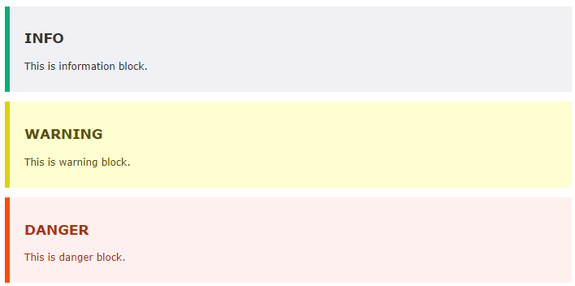

# Redmine Callout Macro Plugin

This plugin adds Callouts(Hints, Custom Containers) to wiki formated fields. 

> [!IMPORTANT]
> If you use `CommonMark Markdown (GitHub Flavored)` for `Text formatting` , you do not need this plugin.  
> https://docs.github.com/en/get-started/writing-on-github/getting-started-with-writing-and-formatting-on-github/basic-writing-and-formatting-syntax#alerts

## Example

```
{{info(INFO)
This is information block.
}}
{{warning(WARNING)
This is warning block.
}}
{{danger(DANGER)
This is danger block.
}}
```



## Installation

1. Clone or copy files into the Redmine plugins directory
   ```
   git clone https://github.com/taikii/redmine_callout_macro.git plugins/redmine_callout_macro
   ```
2. Restart Redmine

## License

[MIT](LICENSE)
